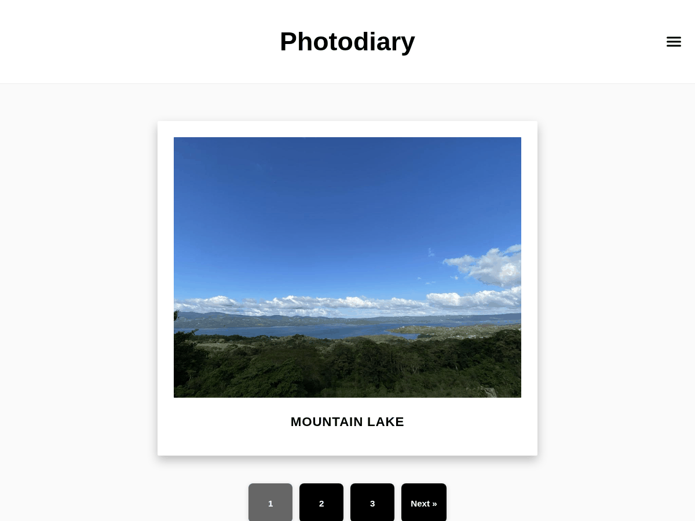

# 📸 Photodiary - A Modern Daily Photo Blog Theme



**A beautifully crafted WordPress theme designed for visual storytelling and daily photography journals.**

## [Live Demo](https://tagebuch.huenerfuerst.de)


---

## ✨ Features

- **🖼️ Polaroid-Style Design** - Classic instant photo aesthetic with modern web standards
- **🌙 Dark Mode Toggle** - Seamless light/dark theme switching with localStorage persistence
- **📱 Fully Responsive** - Perfect viewing experience across all devices
- **♾️ Infinite Scroll** - Optional infinite scrolling or traditional pagination
- **📅 Advanced Archive System** - Hierarchical year/month navigation
- **🌍 Translation Ready** - Includes translations for 5 common languages
- **⚡ Performance Optimized** - Clean code, minimal dependencies
- **🎨 Customizer Integration** - Easy theme configuration through WordPress Customizer
- **🔧 Developer Friendly** - Well-documented, semantic HTML5, and extensible

## 🚀 Quick Start

1. **Download the theme**
   ```bash
   git clone https://github.com/Snake16547/Photodiary-WordPress-Theme.git
   ```

2. **Upload to WordPress**
   ```
   Upload to /wp-content/themes/photodiary/
   ```

3. **Activate the theme**
   - Go to WordPress Admin → Appearance → Themes
   - Activate "Photodiary"

4. **Customize your site**
   - Navigate to **Appearance → Customize**
   - Configure infinite scroll and other options

## 📋 Requirements

- **WordPress:** 5.8 or higher
- **PHP:** 7.4 or higher  
- **Browser Support:** Modern browsers (Chrome, Firefox, Safari, Edge)

## 🌐 Translations

Built-in support for multiple languages:

| Language | Code | Status |
|----------|------|--------|
| English | `en` | ✅ Default |
| Spanish | `es_ES` | ✅ Complete |
| French | `fr_FR` | ✅ Complete |
| German | `de_DE` | ✅ Complete |
| Italian | `it_IT` | ✅ Complete |
| Portuguese (Brazil) | `pt_BR` | ✅ Complete |

## 🛠️ Customization Options

### Theme Customizer Settings

Access via **WordPress Admin → Appearance → Customize**:

- **Infinite Scroll Toggle** - Enable/disable infinite scrolling
- **Custom Logo Support** - Upload your brand logo
- **Site Identity** - Configure site title and tagline

### User Controls

- **Dark Mode** - Toggle available in navigation menu
- **Archive Navigation** - Automatic year/month organization

## 🎨 Design Features

### Polaroid Layout
- White border frames around images
- Subtle drop shadows for depth
- Responsive image scaling
- Caption area for titles

### Dark Mode
- Smooth transitions between themes
- Persistent user preference storage
- Consistent styling across all elements

### Navigation
- Overlay-style mobile menu
- Hierarchical archive system
- Touch-friendly controls

## 📁 File Structure

```
photodiary/
├── assets/
│   ├── css/
│   │   ├── darkmode.css      # Dark mode styles
│   │   └── polaroid.css      # Polaroid component styles
│   └── js/
│       ├── darkmode.js       # Theme toggle functionality
│       └── infinite-scroll.js # Infinite scroll implementation
├── languages/
│   ├── photodiary.pot        # Translation template
│   ├── es_ES.po             # Spanish translations
│   ├── fr_FR.po             # French translations
│   ├── de_DE.po             # German translations
│   ├── it_IT.po             # Italian translations
│   └── pt_BR.po             # Portuguese translations
├── template-parts/
│   ├── content-photo.php     # Photo post template
│   └── content-single.php    # Single post template
├── style.css                 # Main stylesheet
├── functions.php             # Theme functions
├── index.php                 # Main template
├── single.php                # Single post page
├── archive.php               # Archive pages
├── header.php                # Header template
├── footer.php                # Footer template
├── page-archives.php         # Custom archives page
└── screenshot.png            # Theme screenshot
```

## 🎯 Perfect For

- **Daily Photo Blogs** - Document your daily life through images
- **Photography Portfolios** - Showcase your professional work
- **Travel Journals** - Share your adventures visually
- **Lifestyle Bloggers** - Visual storytelling platform
- **Creative Professionals** - Clean, modern presentation
- **Visual Diaries** - Personal photo documentation

## ⚙️ Installation & Setup

### Method 1: Download & Upload

1. Download the latest release from [Releases](https://github.com/Snake16547/Photodiary-WordPress-Theme/releases)
2. Extract the ZIP file
3. Upload the `photodiary` folder to `/wp-content/themes/`
4. Activate via WordPress Admin

### Method 2: Git Clone

```bash
cd /path/to/wordpress/wp-content/themes/
git clone https://github.com/Snake16547/Photodiary-WordPress-Theme.git
```

### Method 3: WordPress Admin

1. Download ZIP from GitHub
2. Go to **Appearance → Themes → Add New → Upload Theme**
3. Upload ZIP file and activate

## 📱 Responsive Breakpoints

| Device | Breakpoint | Layout Changes |
|--------|------------|----------------|
| Desktop | > 768px | Full layout with sidebar navigation |
| Tablet | ≤ 768px | Responsive grid, mobile menu |
| Mobile | ≤ 480px | Single column, optimized touch targets |

## 🎨 Color Palette

### Light Mode
- **Background:** `#fafafa`
- **Text:** `#111111`
- **Cards:** `#ffffff`
- **Accent:** `#000000`

### Dark Mode
- **Background:** `#111111`
- **Text:** `#eeeeee`
- **Cards:** `#222222`
- **Accent:** `#ffffff`

## 🤝 Contributing

We welcome contributions! Here's how you can help:

### Development Setup

1. **Fork the repository**
   ```bash
   git fork https://github.com/Snake16547/Photodiary-WordPress-Theme.git
   ```

2. **Create a feature branch**
   ```bash
   git checkout -b feature/amazing-feature
   ```

3. **Make your changes**
   - Follow WordPress coding standards
   - Test across multiple browsers
   - Ensure responsive design works

4. **Commit your changes**
   ```bash
   git commit -m 'Add some amazing feature'
   ```

5. **Push to the branch**
   ```bash
   git push origin feature/amazing-feature
   ```

6. **Open a Pull Request**
   - Provide clear description of changes
   - Include screenshots if applicable

### Code Standards

- Follow [WordPress PHP Coding Standards](https://developer.wordpress.org/coding-standards/wordpress-coding-standards/php/)
- Use semantic HTML5 elements
- Ensure accessibility compliance (WCAG 2.1)
- Test with WordPress 5.8+ and PHP 7.4+

## 🐛 Issues & Support

### Reporting Issues

Found a bug? Please help us fix it!

1. **Search existing issues** to avoid duplicates
2. **Create a new issue** with:
   - Clear description of the problem
   - Steps to reproduce
   - Expected vs actual behavior
   - WordPress & PHP versions
   - Browser information

### Feature Requests

Have an idea? We'd love to hear it!

- Open an issue with the `enhancement` label
- Describe your use case and proposed solution
- Include mockups or examples if applicable

## 📊 Browser Support

| Browser | Version | Status |
|---------|---------|--------|
| Chrome | 90+ | ✅ Fully Supported |
| Firefox | 88+ | ✅ Fully Supported |
| Safari | 14+ | ✅ Fully Supported |
| Edge | 90+ | ✅ Fully Supported |
| Internet Explorer | 11 | ⚠️ Limited Support |

## 🔄 Changelog

### Version 1.0.0 (2025-08-19)
- **Initial release** 🎉
- Polaroid-style photo layout
- Dark mode toggle functionality
- Infinite scroll option
- Responsive design
- Multi-language support
- Archive system with year/month navigation

## 📄 License

This project is licensed under the **GPL v2 or later** - see the [LICENSE](LICENSE) file for details.

### Third-Party Assets

- **Inter Font** - [Open Font License](https://fonts.google.com/specimen/Inter)
- **Icons** - Custom SVG icons (GPL compatible)

## 🙏 Acknowledgments

- **WordPress Community** - For the amazing platform and resources
- **Contributors** - Everyone who helped make this theme better
- **Beta Testers** - Thank you for your feedback and bug reports
- **Photographers** - Inspiration for the polaroid aesthetic

## 🌟 Show Your Support

If you find this theme useful, please consider:

- ⭐ **Starring this repository**
- 🐦 **Sharing on social media**
- 🤝 **Contributing to the project**

---

**Made with ❤️ for the WordPress community**

[⬆ Back to top](#-photodiary---a-modern-daily-photo-blog-theme)
